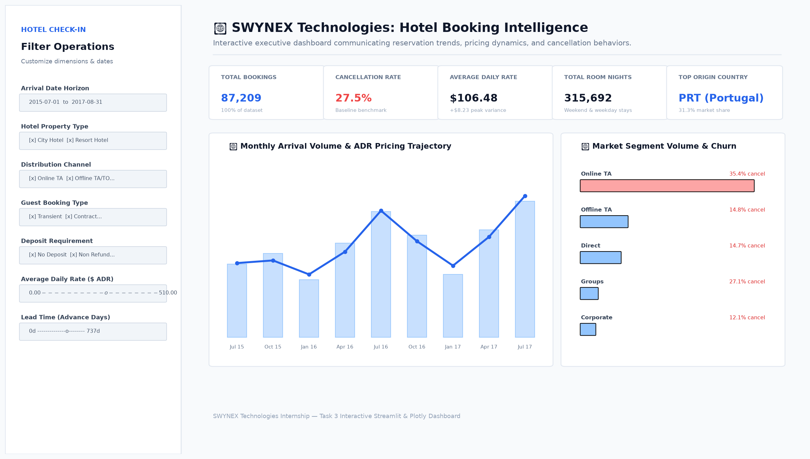
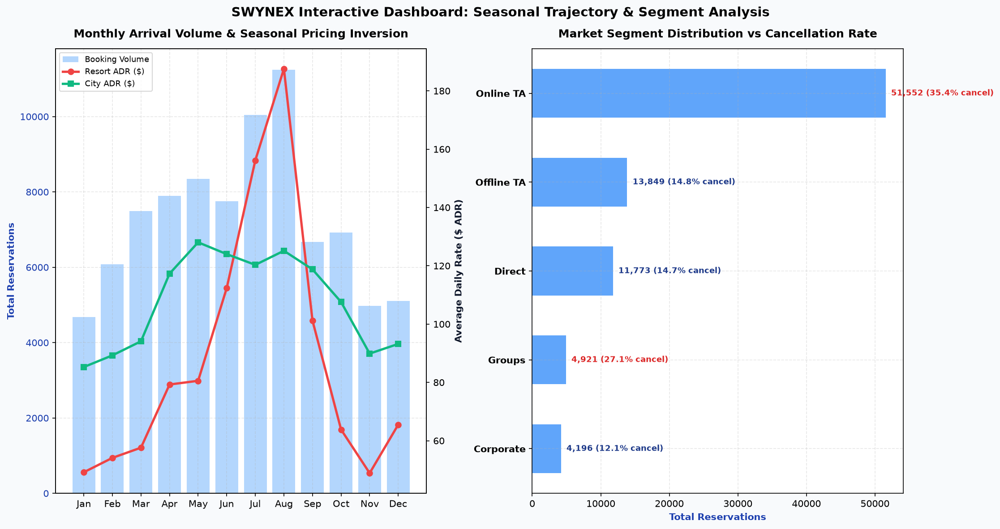
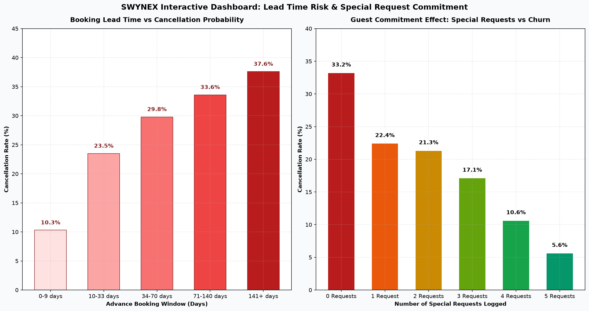
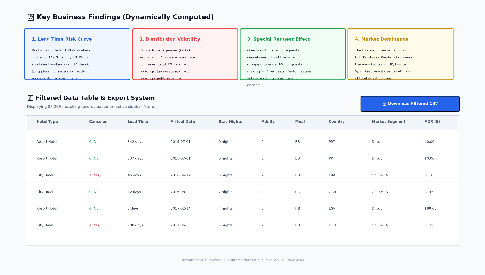

# 🏨 SWYNEX Technologies: Hotel Booking Intelligence Dashboard


> **Internship Assignment:** Task 3 — Interactive Dashboard  
> **Organization:** [SWYNEX Technologies](https://www.linkedin.com/company/swynex-technologies)  
> **Author:** SWYNEX Data Analytics Intern  
> **Repository:** `SWYNEX-Interactive-Dashboard`  
> **Live Dashboard Link:** *[https://swynex-hotel-dashboard.streamlit.app](https://share.streamlit.io)* *(Deploy via Streamlit Community Cloud)*

---

## 📌 Project Overview & Objective
Data storytelling is most impactful when decision-makers can interactively query, slice, and explore operational data in real time. The objective of this project is to build an executive, production-ready interactive dashboard using **Python, Streamlit, and Plotly**, communicating key trends, pricing elasticity, and customer cancellation behaviors from the cleaned **Hotel Booking Demand** dataset.

The dashboard integrates responsive KPI cards, dynamic multidimensional filters, five interactive Plotly charts, real-time synthesized business findings, and an on-demand data export mechanism.

---

## 📊 Dataset Information
* **Dataset Name:** Cleaned Hotel Booking Demand Dataset
* **Source:** Derived from Task 1 data cleaning & Task 2 EDA (`data/cleaned_dataset.csv`), originally authored by Nuno Antonio, Ana de Almeida, and Rui Nunes (2019) in *Data in Brief* / Elsevier ([ScienceDirect Article](https://doi.org/10.1016/j.dib.2018.11.126)) via [TidyTuesday](https://raw.githubusercontent.com/rfordatascience/tidytuesday/master/data/2020/2020-02-11/hotels.csv) & [Kaggle](https://www.kaggle.com/datasets/jessemostipak/hotel-booking-demand).
* **Scope:** 87,209 validated hotel reservations spanning July 2015 to August 2017.
* **Domain:** Hospitality Revenue Management, Pricing Dynamics, and Churn Prevention.

---

## 🧰 Tools & Technologies
* **Framework:** [Streamlit](https://streamlit.io/) (Wide-layout, dynamic session state, custom CSS metrics)
* **Visualization:** [Plotly Express & Graph Objects](https://plotly.com/python/) (Dual-axis time series, histograms, scatter plots, horizontal bars)
* **Data Processing:** [Pandas](https://pandas.pydata.org/) & [NumPy](https://numpy.org/)
* **Configuration:** `.streamlit/config.toml` (Custom executive theme)

---

## 🎛️ Interactive Filters Included
All KPIs and visualizations react in real time to sidebar filters:
1. **Arrival Date Horizon:** Dual calendar selector spanning the continuous booking timeline (July 2015 – August 2017).
2. **Hotel Property Type:** Multiselect between *City Hotel* (53,271 records) and *Resort Hotel* (33,938 records).
3. **Distribution Channel / Market Segment:** Filter by *Online TA, Offline TA/TO, Direct, Groups, Corporate, Aviation, Complementary*.
4. **Guest Booking Type:** Filter across *Transient, Transient-Party, Contract, Group*.
5. **Deposit Requirement:** Filter by *No Deposit, Non Refund, Refundable*.
6. **Average Daily Rate ($ ADR) Slider:** Fine-tune room price ranges from $0 to $510/night.
7. **Lead Time (Advance Days) Slider:** Isolate short-notice vs. long-lead advance bookings (0 to 737 days).
8. **Reset All Filters:** One-click reset returning all inputs to default states.

---

## 📈 Executive KPI Metrics
* **Total Bookings:** Count of matching reservations and percentage share of total dataset.
* **Cancellation Rate (%):** Churn percentage dynamically benchmarked against baseline (27.5%).
* **Average Daily Rate ($ ADR):** Mean room rate per occupied night with variance delta.
* **Total Room Nights:** Cumulative occupied room nights across weekend and weekday stays.
* **Top Origin Country:** Dominant guest nationality and market share.

---

## 🖼️ Dashboard Preview & Visualizations

### 1. Dashboard Overview, Sidebar & KPI Cards


---

### 2. Monthly Seasonality & Market Segment Churn


---

### 3. Lead Time Risk & Guest Commitment Analysis


---

### 4. Key Business Findings & Filtered Data Export


---

## 💡 Key Business Findings (Dynamically Computed)
1. **Lead Time Risk Curve:** Bookings made $\ge 100$ days in advance experience an alarming **37.6% cancellation rate** compared to just **10.3%** for short-lead bookings ($\le 14$ days). Long planning horizons directly erode customer commitment.
2. **Distribution Channel Volatility:** Online Travel Agencies (OTAs) capture 58.9% of bookings but suffer an elevated **35.4% cancellation rate**, whereas **Direct Bookings (14.7%)** and **Corporate clients (12.1%)** provide stable revenue.
3. **The Special Request Commitment Anchor:** Guests with 0 special requests cancel over **33%** of the time, dropping to under **6%** for guests making $\ge 4$ requests. Encouraging room customization anchors customer psychological commitment.
4. **Extreme Summer Pricing Inversion:** Leisure demand peaks in August (11,242 bookings), driving a **281% pricing surge in Resort Hotel rates** ($187.57 vs $49.18 in winter), surpassing City Hotels ($125.15) by 50%.
5. **Geographic Dominance:** Portugal (31.3%), the United Kingdom (12.0%), France (10.1%), and Spain (8.3%) represent over two-thirds of total guest demand.

---

## 📂 Project Repository Structure

```text
SWYNEX-Interactive-Dashboard/
├── data/
│   └── cleaned_dataset.csv             # Cleaned hotel booking dataset (87,209 rows)
├── .streamlit/
│   └── config.toml                     # Streamlit theme & layout configuration
├── screenshots/
│   ├── 01_dashboard_overview.png       # Executive overview, sidebar, and KPI cards
│   ├── 02_seasonal_demand_and_market_segments.png # Dual-axis time-series & segment bars
│   ├── 03_lead_time_and_special_requests.png      # Lead time & special request commitment
│   └── 04_insights_and_data_table.png  # Business findings & expandable data export
├── app.py                              # Streamlit & Plotly interactive dashboard application
├── .gitignore                          # Standard git ignore rules for Python
├── README.md                           # Comprehensive documentation
└── requirements.txt                    # Python package dependencies
```

---

## 🚀 How to Run the Project Locally

### 1. Clone the Repository
```bash
git clone https://github.com/mohanasanthibattula-stack/SWYNEX-Interactive-Dashboard.git
cd SWYNEX-Interactive-Dashboard
```

### 2. Set Up a Virtual Environment (Recommended)
```bash
# Windows
python -m venv venv
venv\Scripts\activate

# macOS / Linux
python3 -m venv venv
source venv/bin/activate
```

### 3. Install Dependencies
```bash
pip install -r requirements.txt
```

### 4. Launch the Interactive Dashboard
```bash
streamlit run app.py
```
*The interactive dashboard will open automatically in your browser at `http://localhost:8501`.*

---

## ☁️ How to Deploy for Free on Streamlit Community Cloud
1. Push this repository to your GitHub account (already completed: `SWYNEX-Interactive-Dashboard`).
2. Visit [share.streamlit.io](https://share.streamlit.io/) and sign in with your GitHub account.
3. Click **"New app"** and select:
   * **Repository:** `mohanasanthibattula-stack/SWYNEX-Interactive-Dashboard`
   * **Branch:** `main`
   * **Main file path:** `app.py`
4. Click **"Deploy!"**. Within 2 minutes, Streamlit Cloud will build and host your live dashboard with a public URL!
